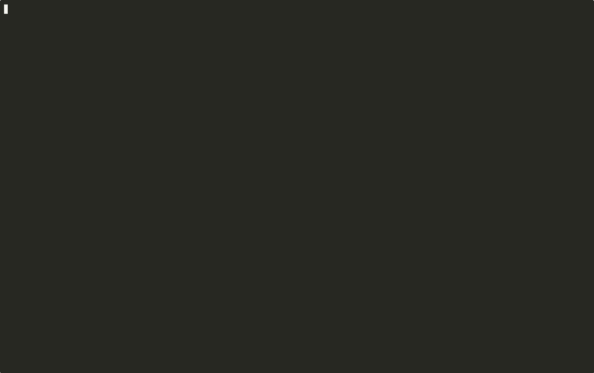
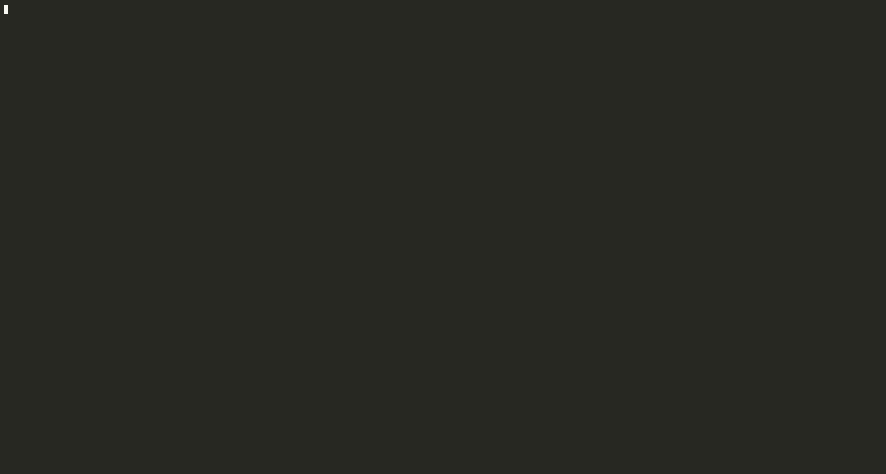
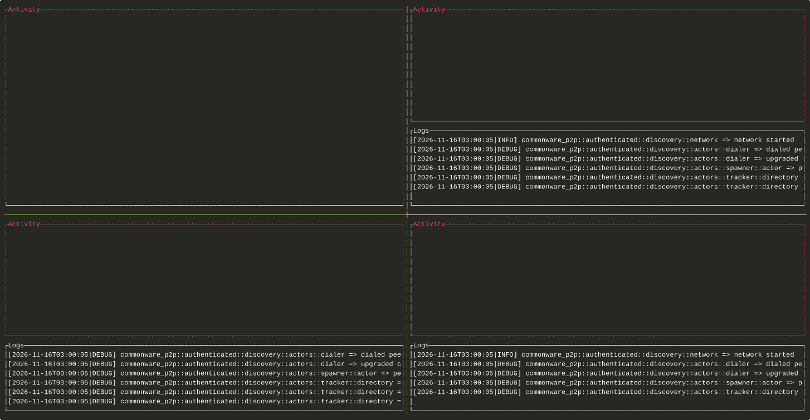
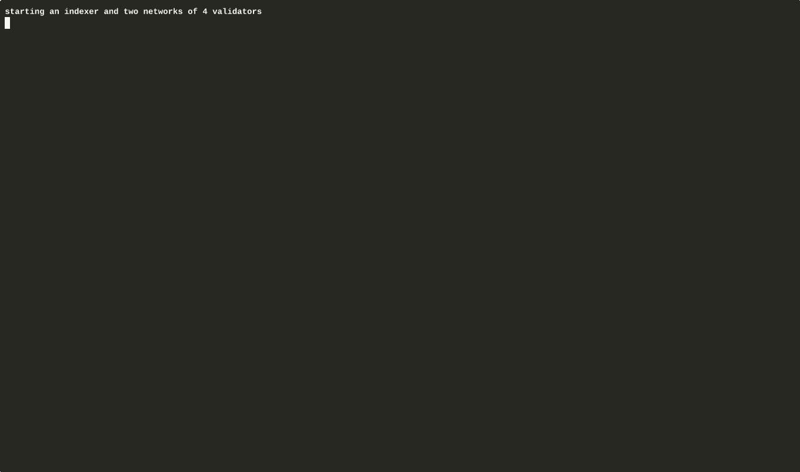

# zigware

[](#installation)
[](#installation)
[](#design)
[](#packages)
[](LICENSE)

zigware is the [Commonware Library](https://github.com/commonwarexyz/monorepo) rewritten from
scratch in Zig: codec, cryptography, a deterministic runtime, storage, authenticated p2p,
broadcast, and BFT consensus, with zero dependencies.

It is a ground-up port of the public commonware monorepo and keeps its layout: every crate
there is a package here with the same name and the same dependency graph, and wire formats
are byte-identical so the two can interoperate.

<p align="center">
  
</p>

The [estimator](examples/estimator) runs a consensus protocol written in a small DSL over
the deterministic runtime and the simulated p2p network, with real AWS inter-region
latencies, and reports when each region crosses each step
([video](docs/assets/estimator-demo.mp4)). Here Simplex finalizes across seven validators in
three regions in about 114 ms at the mean. `zig build run-estimator -- <file.lazy>
--distribution <region:count,...>` runs any protocol in [examples/estimator](examples/estimator).

<p align="center">
  
</p>

[flood](examples/flood) runs four peers as separate processes on real TCP sockets. They find
each other through authenticated p2p discovery, encrypt every connection, and send each other
random messages as fast as the network accepts them. Each peer prints its throughput and
latency every 2 s ([video](docs/assets/flood-demo.mp4)): about 620 messages per second per
peer at around 1 ms mean latency. `etc/scripts/record-demo.sh flood` runs it locally.

<p align="center">
  
</p>

[chat](examples/chat) is an encrypted group chat between friends who know each other's public
keys. Here three peers run as separate processes on the production runtime, connect through
authenticated p2p discovery, and trade messages; each terminal shows the conversation, the
peer's live metrics, and its logs, where p2p discovery reports its handshakes and peer
updates under commonware's event names ([video](docs/assets/chat-demo.mp4)).
`etc/scripts/record-demo.sh chat` records it again.

<p align="center">
  
</p>

zigware and commonware interoperate on the wire. On the left is commonware's own Rust
`examples/chat`, built from the upstream source; on the right is zigware's chat. They find each
other through authenticated p2p discovery, complete the handshake, open encrypted streams, and
each side's message arrives on the other ([video](docs/assets/interop-demo.mp4)).
`etc/scripts/interop.sh` runs the same check without recording (it skips when cargo or the
commonware source is missing), and `etc/scripts/record-demo.sh interop` records it again.

<p align="center">
  
</p>

[log](examples/log) runs [Simplex](src/consensus/simplex) BFT consensus across four
validators, each a separate process on the production runtime connected through authenticated
p2p discovery. Every validator proposes random payloads in turn and shows when each view is
proposed (blue), notarized, and finalized (green), keeping its consensus journal on disk so a
restarted validator resumes where it left off. The Logs panes stream the voter's tracing
events as it broadcasts votes, recovers certificates, and prunes old views
([video](docs/assets/log-demo.mp4)).
`etc/scripts/record-demo.sh log` records it again.

<p align="center">
  
</p>

[bridge](examples/bridge) runs two independent networks of four validators, each with a
threshold BLS12-381 key dealt by `bridge-dealer`, plus an indexer they share. Each network
runs Simplex and proposes either random data or the other network's latest finalization,
which its validators verify against the other network's public identity before voting. The
top pane is the indexer storing blocks and finalizations from both networks; the bottom panes
are one validator from each network, where `block=Bridge(..)` marks a proposal carrying the
other network's finalization ([video](docs/assets/bridge-demo.mp4)).
`etc/scripts/record-demo.sh bridge` records it again.

<p align="center">
  
</p>

[dkg](examples/dkg) follows commonware's flow: `dkg setup` writes configs for five peers
with a committee of four, the epoch-zero players run `bootstrap` to complete a one-shot DKG
and write the genesis, then four `validator`s run Simplex over marshal and a QMDB-backed
stateful application. At every epoch boundary the committee reshares its threshold key on
chain: each pane shows dealings and acks arriving, dealer logs observed on chain,
`completed reshare ceremony ... success=true`, and the orchestrator entering the next epoch
with the new key. After the first reshare, the bottom pane starts a fifth validator with
`--state-sync`: its first block is a peer's floor rather than genesis, and it enters the
current epoch and reshares in step with the rest ([video](docs/assets/dkg-demo.mp4)).
`etc/scripts/record-demo.sh dkg` records it again.

> [!WARNING]
> zigware is pre-alpha and being ported now. Do not use it in production.

## Packages

| Package | What it does | Status |
| --- | --- | --- |
| [codec](src/codec) | Serialize structured data | ported |
| [cryptography](src/cryptography) | Keys, signatures, hashes, BLS12-381 threshold crypto | porting |
| [math](src/math) | Fields, polynomials, NTT | porting |
| [runtime](src/runtime) | Async tasks with a deterministic scheduler or io_uring | porting |
| [storage](src/storage) | Journals, archives, MMRs, authenticated databases | porting |
| [utils](src/utils) | Shared functionality across primitives | ported |
| [parallel](src/parallel) | Parallel folds with pluggable strategies | ported |
| [actor](src/actor) | Coordinate concurrent components | ported |
| [stream](src/stream) | Encrypted messages over any transport | ported |
| [p2p](src/p2p) | Communicate with authenticated peers | porting |
| [broadcast](src/broadcast) | Disseminate data over a wide-area network | ported |
| [resolver](src/resolver) | Resolve data by a fixed-length key | ported |
| [collector](src/collector) | Collect responses to committable requests | ported |
| [coding](src/coding) | Erasure-code data for recovery from fragments | ported |
| [clearing](src/clearing) | Settle actions at scale | porting |
| [consensus](src/consensus) | Order messages in a Byzantine environment (simplex, aggregation, marshal) | porting |
| [glue](src/glue) | Default constructions spanning several primitives | porting |
| [deployer](src/deployer) | Deploy infrastructure across cloud providers | porting |

Support packages: [formatting](src/formatting), [conformance](src/conformance),
[invariants](src/invariants), [simd](src/simd), [allocator](src/allocator),
[bench](src/bench). [docs/ARCHITECTURE.md](docs/ARCHITECTURE.md) maps every commonware crate
to its package and lists the dependency order.

## Design

- **Zero dependencies.** Only the Zig standard library: no C libraries, no vendored code,
  `build.zig.zon` has an empty `.dependencies`. BLS12-381, ed25519, secp256r1, the hashes,
  Reed-Solomon, the runtime, and the storage engines are all implemented here.
- **Same wire formats.** Encodings, storage layouts, and network messages match
  commonware's byte for byte, checked against commonware's own test vectors and
  conformance hashes.
- **Deterministic simulation testing.** All time, randomness, tasks, network, and storage go
  through the runtime. The deterministic runtime runs real protocol code on a simulated
  network with fault injection, and any run replays exactly from its seed.
- **TigerStyle.** Assertions on every precondition, postcondition, and invariant; every
  loop, queue, and mailbox bounded; no recursion; functions ≤ 70 lines. See
  [docs/TIGER_STYLE.md](docs/TIGER_STYLE.md).
- **Fuzzed.** Every decoder, parser, and state machine has a coverage-guided fuzz target
  and a seeded fuzz run that executes with the normal test suite.
- **io_uring.** The production runtime is completion-based IO on Linux, kqueue on macOS.

## Installation

```sh
git clone https://github.com/refcell/zigware && cd zigware
just release
```

`just release` needs [`just`](https://github.com/casey/just) and `curl`. It uses Zig 0.17.1
from `PATH`, or downloads it into `.cache/zig`, and writes optimized binaries to
`zig-out/bin`. zigware has no other build dependency. There are no tagged releases; build
from `main`.

Use a package from your own `build.zig` through the `zigware` module, or one package by
name (`b.dependency("zigware", .{}).module("codec")`).

## Contributing

`just` lists every development recipe. `zig build test` runs every package's tests and
`zig build test-<package>` runs one. Contributor rules are in [AGENTS.md](AGENTS.md); the
port's work split is in [docs/lanes](docs/lanes/README.md) and
[docs/ROADMAP.md](docs/ROADMAP.md).

## License

[MIT](LICENSE). zigware is a port of the Commonware Library, which is dual-licensed under
MIT and Apache 2.0.
