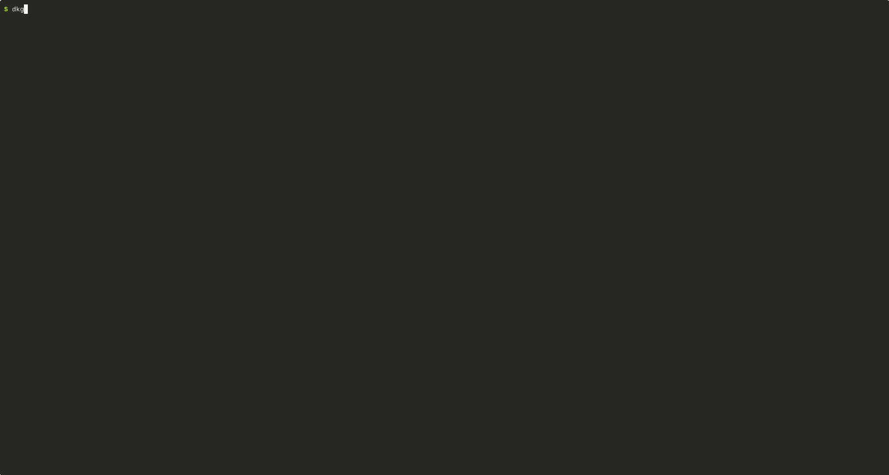

# dkg

Generate and reshare a threshold secret over an epoched log.

A Zig port of commonware's
[`commonware-dkg`](https://github.com/commonwarexyz/monorepo/tree/main/examples/dkg).



([video](../../docs/assets/dkg-demo.mp4); `etc/scripts/record-demo.sh dkg` records it again.)

## Status

Every example is ALPHA upstream
([stability](https://github.com/commonwarexyz/monorepo#stability)). The port runs commonware's
whole flow: `setup`, the epoch-zero `bootstrap`, and `validator`, including `--state-sync`. See
[docs/lanes/examples-dkg.md](../../docs/lanes/examples-dkg.md).

Committees rotate deterministically: for epoch `E`, the committee starts at offset
`E % participants.len()` and takes `committee_size` consecutive participants with wraparound.

The application state is one `any::unordered::fixed` QMDB with one fixed key, and each
non-genesis block writes its height to that key. Genesis carries the epoch-0 `EpochInfo`.

## Usage

Generate the node configurations:

```sh
zig build run-dkg -- setup --node-dir /tmp/zigware-dkg/data --peers 6 --committee-size 4 \
    --base-port 3000
```

`setup` creates every `validator-*` directory with node and network config, then prints
`mprocs` commands to run the epoch-0 bootstrap players and the validators:

```txt
Run bootstrap with:
mprocs "zig build run-dkg -- bootstrap --node-dir /tmp/zigware-dkg/data/validator-0" ...
Once every bootstrap logs "bootstrap complete", stop them all and run the cluster with:
mprocs "zig build run-dkg -- validator --node-dir /tmp/zigware-dkg/data/validator-0" ...
```

Use `mprocs` or run its enclosed commands in separate terminals.

`bootstrap` runs the one-shot glue DKG among the epoch-0 players, which generates the initial
threshold secret and the genesis `EpochInfo`. Only the epoch-0 players run it because only they
receive shares. To bootstrap:

1. Start `bootstrap` concurrently for every epoch-0 player.
2. When a player completes, it writes `genesis.json` into its own directory and every
   non-player validator directory, then logs:

   ```txt
   INFO commonware_dkg::bootstrap: bootstrap complete, serving peers until stopped epoch=0
   players=4 next_players=4 directories=3
   ```

   It keeps serving so players that have not completed can catch up from it.
3. Once every player has logged that line, stop every `bootstrap` and start the validators.

`validator` starts from the genesis written by `bootstrap` and runs the application chain,
stateful QMDB, continuous reshare, DKG orchestrator, and DKG probe. Each validator logs every
finalized block and the reshare at each epoch boundary:

```txt
INFO commonware_dkg::types: finalized block epoch=0 height=1 digest=04cfd104...
INFO commonware_glue::dkg::reshare::actor::inclusion: completed reshare ceremony epoch=1 round=1
success=true
INFO commonware_glue::dkg::orchestrator::actor: entered epoch epoch=1
```

Stopping a command run through `zig build run-dkg` makes the build runner print a failed-step
summary (`process terminated with signal TERM`); the node itself stopped cleanly. To run the
binary directly, build it once with `zig build -Doptimize=ReleaseFast` and run
`zig-out/bin/dkg` with the same arguments.

## Storage

Each validator owns one directory under the configured data directory:

```text
data/
  validator-0/
    node.json
    network.json
    genesis.json
    runtime/
```

`node.json` contains the node's Ed25519 signing key and listen/dial addresses. `network.json`
contains the ordered participant list, fixed committee size, and peer dial addresses.
`genesis.json` contains the epoch-0 `EpochInfo`. `runtime/` is the storage root for all blob
partitions used by that node.

Private DKG material lives in two partitions of `runtime/`. `bootstrap` keeps its share, dealer
seed, and received dealings in `bootstrap-secrets`. When the ceremony completes, `bootstrap`
copies only the node's epoch-0 share, if it has one, into `secrets`. `validator` uses `secrets`
for that share and for the shares, dealer seeds, and received dealings of every reshare, and
erases `bootstrap-secrets` when it starts. The bootstrap and the first reshare both store
epoch-0 seeds and dealings, so they must not share a partition.

## State Sync

Start a late joiner with `validator --state-sync`. A late joiner is a node that joins after
launch and whose key is in a future committee. It uses `dkg::probe` to fetch a recent finalized
block and that epoch's public material from peers, saves the block as its sync floor, and
state-syncs QMDB from it instead of replaying from genesis. Nodes that launch the network run
without the flag.

```sh
zig build run-dkg -- validator --node-dir /tmp/zigware-dkg/data/validator-5 --state-sync
```

Started after the others completed epoch 2's reshare, its first finalized block is the floor,
not genesis, and it then reshares with the rest:

```txt
INFO commonware_dkg::types: finalized block epoch=2 height=129 digest=c4d08c00...
INFO commonware_glue::dkg::orchestrator::actor: entered epoch epoch=2
INFO commonware_glue::dkg::reshare::actor::inclusion: completed reshare ceremony epoch=3 round=3
success=true
```

The flag only matters until a node saves a sync floor or starts from genesis. After that, the
node follows its storage: it resumes an unfinished sync or continues from its local blocks, so
keeping the flag on restarts is harmless.

A player that misses its private dealings cannot recover them by syncing. The ceremony
completes without it and publicly reveals its share.

A validator that holds a share for the current epoch takes part in its ceremony and must stay
online for the whole epoch. If its sync floor lands past the epoch's midpoint, it sits out the
ceremony and cannot vote to finalize the epoch's final block. It then counts as a faulty
validator at that block, so the block finalizes only once `2f + 1` other validators vote to
finalize it.

## Testing

```sh
zig build test-example-dkg   # this example's tests
zig build run-dkg -- --help  # the CLI
```

## Differences from commonware

- `setup` prints `zig build run-dkg -- ...` where commonware prints
  `cargo run --bin commonware-dkg -- ...`
  ([decisions](../../docs/lanes/examples-dkg.md#decisions)).
- `--worker-threads` is parsed and ignored: the production runtime runs on `std.Io.Threaded`,
  not Tokio ([decisions](../../docs/lanes/examples-dkg.md#decisions)).
- Marshal's partition is `validator-marshal` (commonware: `validator`), since `validator`
  builds marshal from glue's bootstrap `Node`
  ([decisions](../../docs/lanes/examples-dkg.md#decisions)).
