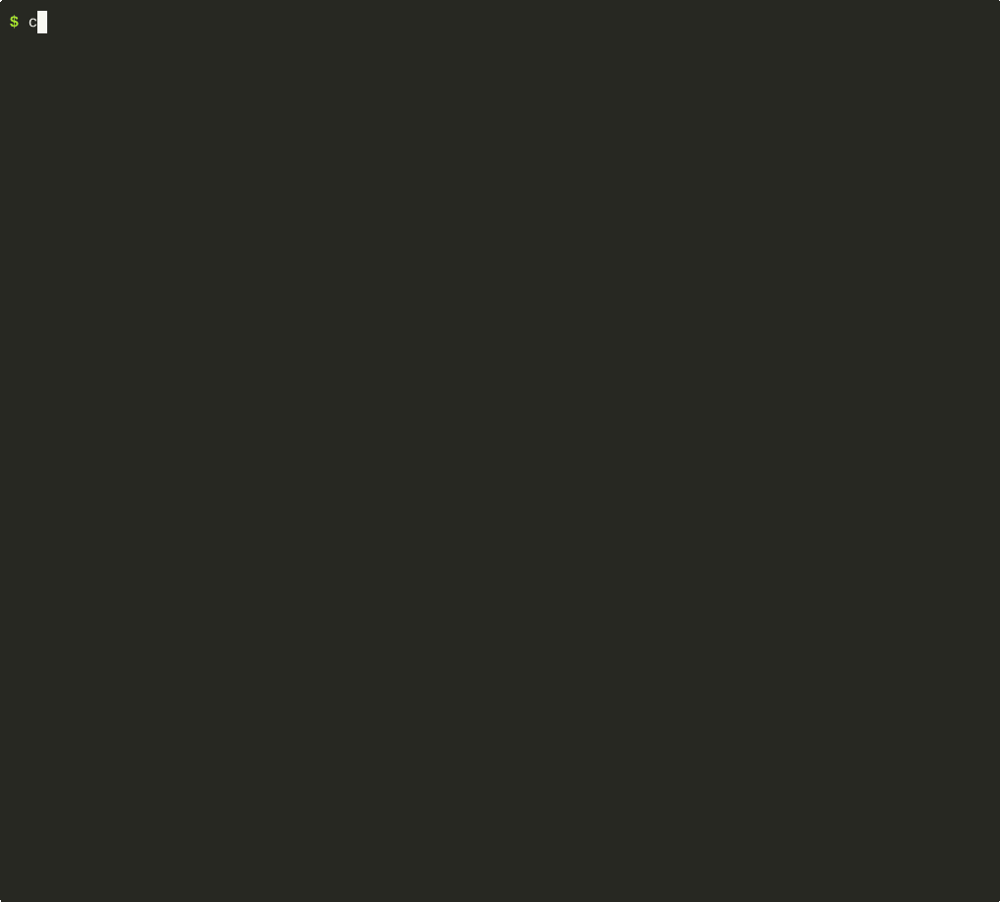

# estimator

Simulate mechanism performance under realistic network conditions. This is a Zig port of
commonware's [`commonware-estimator`](https://github.com/commonwarexyz/monorepo/tree/main/examples/estimator).

You describe a mechanism in a small `.lazy` DSL (`propose`, `broadcast`, `reply`,
`wait`/`collect` with thresholds and delays, `&&`, `||`, and parentheses). The estimator runs it
once per proposer. Each run uses the deterministic runtime and p2p's simulated network, with
peers spread across AWS regions at cloudping.co's region-to-region latencies (P50, with
jitter from P90) in virtual time. It then prints latency statistics (mean, median, standard
deviation) per proposer and averaged over all runs.



([video](../../docs/assets/estimator-demo.mp4); `etc/scripts/record-demo.sh estimator` records
it again.) Here Simplex finalizes across seven validators in three regions in about 114 ms at
the mean.

## Usage

```sh
# 5 peers: 3 in us-east-1, 2 in eu-west-1, unlimited bandwidth
zig build run-estimator -- examples/estimator/hotstuff.lazy --distribution us-east-1:3,eu-west-1:2

# With bandwidth limits in bytes per second (asymmetric egress/ingress, or symmetric)
zig build run-estimator -- examples/estimator/simplex_large_block.lazy \
    --distribution us-east-1:3:1000000/500000,eu-west-1:2:2000000

# An Alto-like network: 50 peers over 10 regions
zig build run-estimator -- examples/estimator/simplex.lazy \
    --distribution us-west-1:5,us-east-1:5,eu-west-1:5,ap-northeast-1:5,eu-north-1:5,ap-south-1:5,sa-east-1:5,eu-central-1:5,ap-northeast-2:5,ap-southeast-2:5

# For a fast binary, build with optimizations and run it directly
zig build -Doptimize=ReleaseFast && ./zig-out/bin/estimator examples/estimator/minimmit.lazy \
    --distribution us-east-1:5,eu-west-1:5
```

`--help` lists the options. The latency data in `p50.json` and `p90.json` is embedded;
`--reload` downloads the last year's matrices from cloudping.co instead.

Every `.lazy` file in this directory is commonware's. The DSL is documented in commonware's
README, and the parser, error messages, and semantics are the same here.

## Output and agreement with commonware

The output format matches commonware's byte for byte: the same lines, the same `{:.2}`
rounding, and the same ANSI colors (`NO_COLOR`, `CLICOLOR`, and `CLICOLOR_FORCE` behave as
they do with Rust's `colored` crate). The same holds for the two debug lines, `--help`, and
the usage errors.

The statistics agree with commonware's **in distribution, not sample for sample**. Each
latency sample is drawn exactly as commonware draws it (rand_distr's ziggurat `Normal` over
the same ChaCha12 RNG). However, zigware's scheduler and simulated network consume the RNG
in a different order than commonware's executor does, so a given seed yields a different
sequence of samples. Runs are deterministic: the same arguments always print the same
numbers.

`simulate_test.zig` checks this against `testdata/simplex_commonware.txt`, the commonware
binary's output for `simplex.lazy --distribution us-east-1:5,eu-west-1:5,ap-northeast-1:5`.
Every line must match with the numbers masked. Each aggregated mean must be within 2% (or
2 ms) of commonware's, and each median within 3% (or 5 ms).
