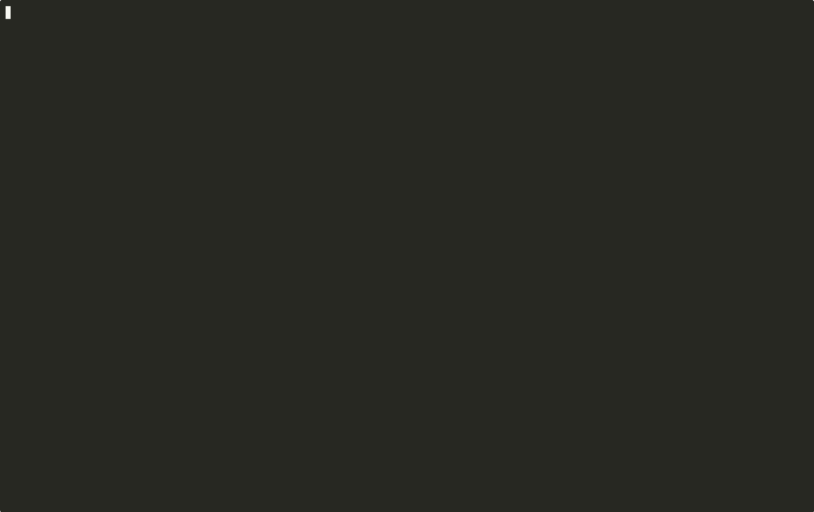

# flood

Flood peers with random messages.

A Zig port of commonware's
[`commonware-flood`](https://github.com/commonwarexyz/monorepo/tree/main/examples/flood), which
floods peers deployed to AWS EC2 with the deployer.



([video](../../docs/assets/flood-demo.mp4); `etc/scripts/record-demo.sh flood` records it again.)

## Status

Every example is ALPHA upstream
([stability](https://github.com/commonwarexyz/monorepo#stability)). The port is complete: the
`flood` binary on `p2p.authenticated.discovery` and the production runtime, and `setup`, which
writes a deployment for the deployer. See
[docs/lanes/examples-estimator.md](../../docs/lanes/examples-estimator.md).

## Run Locally

zigware adds a local deployment, so flood runs on one machine without AWS. `local.sh` writes
the deployer's `hosts.yaml` and one config per peer. Peer `i` listens on `127.0.0.<i>`, so every
peer keeps flood's fixed ports (4545 for p2p, 9090 for metrics):

```sh
zig build -Doptimize=ReleaseFast
examples/flood/local.sh 4 /tmp/zigware-flood
```

`demo.sh` then runs every peer on this machine, interleaving their JSON logs, and every two
seconds prints what each peer received from its metrics endpoint:

```sh
examples/flood/demo.sh /tmp/zigware-flood 6
```

```txt
peer       received   messages/s   mean_latency   after 6s
peer 1         4307          642       1.564 ms
peer 2         4023          637       2.521 ms
peer 3         3460          632       2.847 ms
peer 4         3938          630       1.249 ms
```

## Deploy to AWS

### Create Deployer Artifacts

```sh
zig build run-flood-setup -Doptimize=ReleaseFast -- --peers 3 --bootstrappers 1 \
    --regions us-west-2,us-east-1,eu-west-1 --instance-type c7g.xlarge --storage-size 10 \
    --storage-class gp3 --worker-threads 4 --message-size 1024 --message-rate 16384 \
    --mailbox-size 16384 --dashboard dashboard.json --instrument true --output assets
```

_We use 3 peers (instead of the 2 required to test connection performance) to demonstrate that
peer discovery works._

`setup` writes one config per peer and the deployer's `config.yaml` into `assets`, with the
peers spread over the regions in turn:

```txt
info(setup): generated deployment tag: tag=14a3c41c-1f05-48de-be9b-cc511243244e
info(setup): wrote configuration files: path=assets/config.yaml
```

`--dashboard` takes a Grafana dashboard to copy into `assets`; commonware's
[`dashboard.json`][dashboard] works as is.

[dashboard]: https://github.com/commonwarexyz/monorepo/blob/main/examples/flood/dashboard.json

### Deploy

From `assets`, the deployer (`zig build run-deployer -- aws ...`) creates, updates, and destroys
the deployment as commonware's README describes, with `aws create`, `aws update`, and
`aws destroy` and `--config config.yaml`. This README does not show those commands' output:
they were not run against AWS for it.

## Testing

```sh
zig build test-example-flood          # this example's tests
zig build run-flood -- --help         # the flood binary's CLI
zig build run-flood-setup -- --help   # setup's CLI
```

## Differences from commonware

- flood reads YAML with its own parser for the subset serde_yaml writes for flood's config and
  the deployer's hosts file ([decisions](../../docs/lanes/examples-estimator.md#decisions)).
- A peer whose host IP is loopback binds that IP instead of `0.0.0.0`, so local peers share
  flood's fixed ports on `127.0.0.1`, `127.0.0.2`, and so on
  ([decisions](../../docs/lanes/examples-estimator.md#decisions)).
- The local deployment (`local.sh`, `demo.sh`) is zigware's; commonware runs flood only on EC2.
- commonware builds an ARM64 binary for EC2 with Docker; Zig cross-compiles without it, for
  example with `zig build -Doptimize=ReleaseFast -Dtarget=aarch64-linux`.
