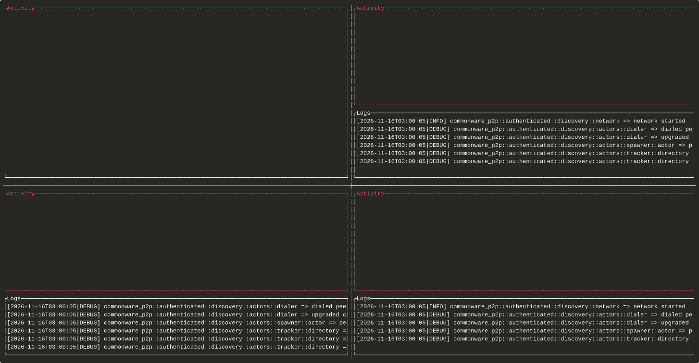

# log

Commit to a secret log and agree to its hash.

A Zig port of commonware's
[`commonware-log`](https://github.com/commonwarexyz/monorepo/tree/main/examples/log).



([video](../../docs/assets/log-demo.mp4?raw=true); `etc/scripts/record-demo.sh log` records it
again.)

## Status

Every example is ALPHA upstream
([stability](https://github.com/commonwarexyz/monorepo#stability)). The port is complete: the
CLI, the application, and the terminal UI, with participants running Simplex over
`p2p.authenticated.discovery` on the production runtime. See
[docs/lanes/examples-estimator.md](../../docs/lanes/examples-estimator.md).

## Usage (Run at Least 3 to Make Progress)

Run each participant in its own terminal. Each one shows an Activity pane with every view it
proposed, notarized, and finalized, and a Logs pane with Simplex's and p2p's events.

### Participant 0 (Bootstrapper)

```sh
zig build run-log -Doptimize=ReleaseFast -- --me 0@3000 --participants 0,1,2,3 \
    --storage-dir /tmp/zigware-log/0
```

### Participant 1

```sh
zig build run-log -Doptimize=ReleaseFast -- --bootstrappers 0@127.0.0.1:3000 --me 1@3001 \
    --participants 0,1,2,3 --storage-dir /tmp/zigware-log/1
```

### Participant 2

```sh
zig build run-log -Doptimize=ReleaseFast -- --bootstrappers 0@127.0.0.1:3000 --me 2@3002 \
    --participants 0,1,2,3 --storage-dir /tmp/zigware-log/2
```

### Participant 3

```sh
zig build run-log -Doptimize=ReleaseFast -- --bootstrappers 0@127.0.0.1:3000 --me 3@3003 \
    --participants 0,1,2,3 --storage-dir /tmp/zigware-log/3
```

Once three are running, their Activity panes fill with lines like these:

```txt
[2026-11-19T06:19:11] => finalized (payload="36df6d43...c9ce570a7" view="112")
[2026-11-19T06:19:11] => proposed (msg="b42ddd36844cd469c2dee7e8b830e84a" payload="d3bbb4d9...")
```

Each participant keeps its consensus journal in its `--storage-dir`. Stop one with Ctrl-C and
run the same command again: it resumes from its journal and finalizes with the rest.

## Testing

```sh
zig build test-example-log   # this example's tests
zig build run-log -- --help  # the CLI
```

## Differences from commonware

None recorded. The Logs pane shows p2p's and Simplex's events at debug and above, and the
Activity pane quotes every value (`view="7"`), as commonware's `gui.rs` prints them
([decisions](../../docs/lanes/examples-estimator.md#decisions)).
